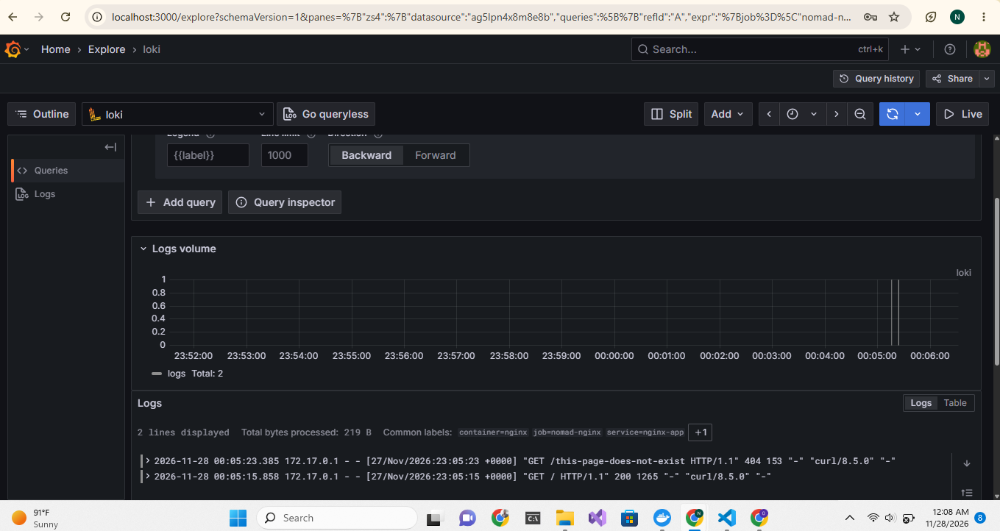

# Containerized NGINX Deployment and Monitoring with DevOps Automation

[](https://github.com/OmoloyeNaeema/devops-intern-final/actions/workflows/ci.yml)

A complete DevOps project demonstrating Linux scripting, Docker containerisation, automated CI/CD, deployment with HashiCorp Nomad, service health monitoring with Consul, and log aggregation using Grafana Loki, Promtail and Grafana.

## 1. Project Overview

This project automates the delivery of a containerised NGINX web application, from source control through continuous integration, image publishing, orchestration and log monitoring.

The application displays the assessment author's name, assessment date and a build identifier injected during Docker image creation.

The project demonstrates an integrated workflow in which GitHub Actions builds and tests the Docker image, publishes it to GitHub Container Registry (GHCR), and Nomad deploys the published image.

## 2. Architecture

```text
                 Developer
                     |
                     v
                GitHub Repo
                     |
                     v
               GitHub Actions
             /      |       \
          Lint     Build     Test
                     |
                     v
              GitHub Container
                 Registry
                     |
                     v
                Nomad
                     |
                     v
               NGINX App
                     |
                Consul Health
                   Checks

        NGINX Allocation Logs
                     |
                     v
                  Promtail
                     |
                     v
                    Loki
                     |
                     v
                  Grafana
```

## 3. Technology Stack and Prerequisites

The project was developed and tested with the following environment:

| Technology | Version |
|---|---|
| Operating system | Ubuntu 24.04.1 LTS |
| Docker CLI | 29.5.3 |
| Docker Engine | 29.5.3 |
| Docker Compose | v5.1.4 |
| Nomad | v2.1.1 |
| Consul | v2.1.0 |
| ShellCheck | 0.9.0 |
| NGINX base image | nginx:1.27-alpine |
| Loki | 3.5.0 |
| Promtail | 3.5.0 |
| Grafana | 12.2.0 |

Development environment: Ubuntu running through Windows Subsystem for Linux 2 (WSL2), integrated with Docker Desktop.

Prerequisites:

- Git
- Docker Desktop with WSL2 integration
- Ubuntu terminal
- HashiCorp Nomad
- HashiCorp Consul
- ShellCheck

## 4. Repository Structure

```text
devops-intern-final/
├── .github/
│   └── workflows/
│       └── ci.yml
├── app/
│   ├── Dockerfile
│   ├── index.html
│   └── nginx.conf
├── docs/
│   └── screenshots/
│       ├── grafana-explore.png
│       ├── grafana-explore2.png
│       └── grafana-explore-labels.png
├── monitoring/
│   ├── docker-compose.yaml
│   ├── loki-config.yaml
│   ├── promtail-config.yaml
│   └── loki_setup.md
├── nomad/
│   └── nginx-app.nomad.hcl
├── scripts/
│   ├── healthcheck.sh
│   └── sysinfo.sh
├── .gitignore
└── README.md
```

## 5. Quick Start

The following commands take a user from cloning the repository to running the application.

```bash
git clone https://github.com/OmoloyeNaeema/devops-intern-final.git
cd devops-intern-final
docker build --build-arg BUILD_SHA=local-test -t devops-intern-final:v1 ./app
docker run -d --name devops-nginx -p 8080:8080 devops-intern-final:v1
./scripts/healthcheck.sh http://localhost:8080
```

Open the application:

`http://localhost:8080`

The application health endpoint is:

`http://localhost:8080/healthz`

## 6. Task 1 — Source Control and GitHub

A public GitHub repository was created:

https://github.com/OmoloyeNaeema/devops-intern-final

The project uses incremental commits and conventional commit messages.

Feature branches and pull requests were used to introduce and review the CI/CD, monitoring and final configuration changes.

Merged pull requests:

| Pull request | Description |
|---|---|
| PR #1 | Automated CI/CD pipeline |
| PR #2 | Nomad deployment and Loki monitoring |
| PR #3 | Promtail container label and monitoring documentation corrections |

The final release tag is:

`v1.0.0`

The release tag points to final commit:

`063a59afc1dfad14a5910fd89ef6c9832c2b3caa`

Verify the tag:

```bash
git ls-remote --tags origin 'v1.0.0*'
```

The repository is public and the final changes are merged into `main`.

## 7. Task 2 — Linux Scripting

Two executable Bash scripts were created under `scripts/`.

### 7.1 System Information Script

File: `scripts/sysinfo.sh`

The script reports:

- Current user and effective UID.
- Hostname and kernel release.
- System date in ISO 8601 format.
- Disk usage.
- Memory usage.
- Docker daemon status.

Run:

```bash
chmod +x scripts/sysinfo.sh
./scripts/sysinfo.sh
```

Observed output included:

```text
===== SYSTEM INFORMATION =====
Current User: devops26
Effective UID: 1000
Hostname: DESKTOP-V44SR4C
Kernel: Linux 5.15.167.4-microsoft-standard-WSL2
Date: 2026-11-27T23:40:10Z

===== DISK USAGE =====
Filesystem      Size  Used Avail Use% Mounted on
/dev/sdc       1007G  3.3G  953G   1% /

===== MEMORY USAGE =====
Mem:           3.7Gi       1.5Gi       554Mi

===== DOCKER STATUS =====
Docker daemon is running.
```

### 7.2 Application Health Check Script

File: `scripts/healthcheck.sh`

The script:

- Accepts a target URL.
- Defaults to `http://localhost:8080`.
- Checks the HTTP response.
- Returns exit code 0 for HTTP 200.
- Returns a non-zero exit code for a failed request.

Run:

```bash
chmod +x scripts/healthcheck.sh
./scripts/healthcheck.sh http://localhost:8080
```

Observed successful output:

```text
Checking application at: http://localhost:8080
SUCCESS: Application is healthy (HTTP 200)
```

A negative test was also performed using a nonexistent page, which returned HTTP 404 and caused the health check to fail as expected.

Both scripts passed ShellCheck without reported errors.

```bash
shellcheck scripts/sysinfo.sh scripts/healthcheck.sh
```

## 8. Task 3 — Docker Containerisation

The NGINX application is contained in `app/`.

Files:

- `app/Dockerfile`
- `app/index.html`
- `app/nginx.conf`

The Dockerfile:

- Uses the pinned `nginx:1.27-alpine` base image.
- Runs NGINX as a non-root user.
- Exposes port 8080.
- Defines a Docker HEALTHCHECK.
- Accepts the `BUILD_SHA` build argument.
- Injects the build identifier into the served HTML page.

### Build the image

Exact build command:

```bash
docker build --build-arg BUILD_SHA=local-test -t devops-intern-final:v1 ./app
```

### Run the container

Exact run command:

```bash
docker run -d --name devops-nginx -p 8080:8080 devops-intern-final:v1
```

### Docker image size

The published image was checked with:

```bash
docker images ghcr.io/omoloyenaeema/devops-intern-final:latest
```

Observed Docker CLI values:

| Measurement | Result |
|---|---:|
| Content size | 21 MB |
| Local disk usage | 73.8 MB |

The reported content size is below the assessment's 60 MB threshold. The local disk usage is reported separately by Docker and should not be confused with the content-size measurement.

### Test the application root

```bash
curl -i http://localhost:8080/
```

Observed response excerpt:

```text
HTTP/1.1 200 OK
Server: nginx/1.27.5
Content-Type: text/html
Content-Length: 1235
```

The application returned its HTML page successfully.

### Test the health endpoint

```bash
curl -i http://localhost:8080/healthz
```

Observed response:

```text
HTTP/1.1 200 OK
Server: nginx/1.27.5
Content-Type: text/plain
Content-Length: 8

healthy
```

## 9. Task 4 — Continuous Integration and Continuous Delivery

GitHub Actions configuration:

`.github/workflows/ci.yml`

The pipeline runs on pushes to `main` and the configured feature branch, and on pull requests targeting `main`.

It contains four jobs:

1. **Lint:** Runs ShellCheck and Hadolint.
2. **Build:** Builds the Docker image with the GitHub commit SHA as `BUILD_SHA`.
3. **Test:** Starts the container and checks application readiness.
4. **Publish:** Publishes the image to GHCR on pushes to `main`.

The pipeline uses `GITHUB_TOKEN` and least-privilege workflow permissions for image publishing.

Published image:

```text
ghcr.io/omoloyenaeema/devops-intern-final:latest
```

The pipeline also publishes the image with the commit SHA as its tag.

### Final pipeline verification

The final main-branch workflow run was:

`46082066833`

All four jobs completed successfully:

| Job | Result |
|---|---|
| Lint Shell Scripts and Dockerfile | Passed |
| Build Docker Image | Passed |
| Test Docker Container | Passed |
| Publish Image to GHCR | Passed |

The CI badge at the top of this README links to the GitHub Actions workflow.

Workflow history:

https://github.com/OmoloyeNaeema/devops-intern-final/actions

## 10. Task 5 — Orchestration with Nomad and Consul

The Nomad job specification is:

`nomad/nginx-app.nomad.hcl`

It deploys one NGINX application task using the Docker driver.

Configuration:

- Job type: `service`
- One group and one task.
- GHCR image with a parameterised HCL image tag.
- CPU: 100 MHz.
- Memory: 64 MB.
- Dynamic port allocation named `http`.
- Container port: 8080.
- Consul HTTP health check against `/healthz`.
- Check interval: 10 seconds.
- Check timeout: 2 seconds.
- Rolling deployment with `max_parallel = 1`.
- Minimum healthy time: 10 seconds.
- Healthy deadline: 2 minutes.
- Automatic rollback enabled.
- Restart and reschedule policies configured.

### Validate the job

```bash
nomad job validate nomad/nginx-app.nomad.hcl
```

Observed result:

```text
Job validation successful
```

### Plan the deployment

```bash
nomad job plan -var="image_tag=latest" nomad/nginx-app.nomad.hcl
```

The job plan completed successfully and showed the task allocation.

### Deploy the job

```bash
nomad job run -var="image_tag=latest" nomad/nginx-app.nomad.hcl
```

Final observed deployment:

```text
Deployment ID = c0bd3501
Job ID        = nginx-app
Job Version   = 0
Status        = successful

Task Group  Desired  Placed  Healthy  Unhealthy
nginx       1        1       1        0
```

### Check job status

```bash
nomad job status nginx-app
```

Final observed status:

```text
ID          = nginx-app
Status      = running

Task Group  Queued  Starting  Running  Failed
nginx       0       0         1        0

Latest Deployment
Status      = successful
Description = Deployment completed successfully

Deployed
Task Group  Desired  Placed  Healthy  Unhealthy
nginx       1        1       1        0
```

One allocation was running and healthy.

### Verify Consul health

```bash
curl http://localhost:8500/v1/health/checks/nginx-app
```

Observed result:

```text
Status: passing

HTTP GET http://127.0.0.1:29123/healthz:
200 OK
Output: healthy

Interval: 10s
Timeout: 2s
```

The dynamic port may change when Nomad creates a new allocation.

## 11. Task 6 — Log Aggregation with Loki, Promtail and Grafana

The monitoring stack is defined in:

- `monitoring/docker-compose.yaml`
- `monitoring/loki-config.yaml`
- `monitoring/promtail-config.yaml`
- `monitoring/loki_setup.md`

### Start the monitoring stack

```bash
docker compose -f monitoring/docker-compose.yaml up -d
```

Services:

| Service | Port | Purpose |
|---|---:|---|
| Loki | 3100 | Log storage |
| Promtail | 9080 | Log collection |
| Grafana | 3000 | Log visualisation |

### Verify Loki readiness

```bash
curl http://localhost:3100/ready
```

Observed response:

```text
ready
```

### Promtail collection and labels

Promtail collects NGINX standard output logs from Nomad allocation directories.

The mounted allocation directory is:

```text
Host:      $HOME/nomad-dev-data/alloc
Container: /var/lib/nomad/alloc
```

The scrape path is:

```text
/var/lib/nomad/alloc/*/alloc/logs/nginx.stdout.*
```

The final Promtail configuration attaches these labels:

| Label | Value |
|---|---|
| `job` | `nomad-nginx` |
| `container` | `nginx` |
| `service` | `nginx-app` |

### Configure Grafana

Open:

`http://localhost:3000`

Configure Loki as a Grafana data source with this URL:

```text
http://loki:3100
```

Then open **Explore** and select Loki.

### LogQL queries

Display NGINX application logs:

```logql
{job="nomad-nginx", container="nginx", service="nginx-app"}
```

Filter successful HTTP requests:

```logql
{job="nomad-nginx", container="nginx", service="nginx-app"} |= " 200 "
```

Filter unsuccessful HTTP requests:

```logql
{job="nomad-nginx", container="nginx", service="nginx-app"} |= " 404 "
```

### Verify successful and unsuccessful requests

Successful request:

```bash
curl -i http://127.0.0.1:27571/
```

Observed status: HTTP 200.

Unsuccessful request:

```bash
curl -i http://127.0.0.1:27571/this-page-does-not-exist
```

Observed status: HTTP 404.

The requests were collected by Promtail, stored in Loki and displayed in Grafana Explore.

Final Grafana verification showed:

- 2 fresh log entries.
- 219 bytes processed.
- One HTTP 200 request.
- One HTTP 404 request.
- All three expected labels: `job`, `container` and `service`.

The following screenshot shows the final LogQL query and the collected NGINX logs with all three labels:



Additional Grafana Explore evidence is available in:

- `docs/screenshots/grafana-explore.png`
- `docs/screenshots/grafana-explore2.png`

Further setup details, commands and troubleshooting are recorded in [monitoring/loki_setup.md](monitoring/loki_setup.md).

## 12. Task 7 — Documentation

This README documents the application, source control, Docker build and run process, Linux scripts, CI/CD pipeline, Nomad deployment, Consul health checks and Loki monitoring.

Supporting screenshots are stored in `docs/screenshots/` and referenced in the relevant sections.

## 13. Troubleshooting

The following issues were encountered and resolved during implementation.

### Issue 1: Nomad agent port conflict

**Problem:** A previously running Nomad agent was already using the development port.

**Resolution:** Identified and stopped the stale agent, then restarted Nomad using an explicit data directory:

```bash
nomad agent -dev -data-dir="$HOME/nomad-dev-data"
```

### Issue 2: Nomad reschedule policy validation

**Problem:** The reschedule policy had conflicting settings for retry attempts and unlimited rescheduling.

**Resolution:** Set `unlimited = false` alongside the configured retry attempts.

### Issue 3: Consul health-check CLI command

**Problem:** The attempted `consul health checks nginx-app` command was unsupported by the installed Consul CLI.

**Resolution:** Used the Consul HTTP API instead:

```bash
curl http://localhost:8500/v1/health/checks/nginx-app
```

### Issue 4: Promtail Docker Desktop bind-mount failure

**Problem:** Restarting the existing Promtail container failed with a Docker Desktop bind-mount error.

**Resolution:** Confirmed that the configuration file existed and recreated only Promtail:

```bash
docker compose -f monitoring/docker-compose.yaml up -d --force-recreate promtail
```

Promtail then loaded the updated configuration and resumed collecting allocation logs.

### Issue 5: Loki readiness delay

**Problem:** The initial Loki readiness check returned HTTP 503 while the ingester was still initialising.

**Resolution:** Waited for Loki to complete startup and checked readiness again. Loki subsequently returned `ready`.

## 14. Known Limitations

This project is a local development and assessment deployment, not a production-ready environment.

- Nomad and Consul run in development mode on a single local environment.
- The deployment has one application allocation and does not provide high availability.
- Loki authentication is disabled in the local configuration.
- Grafana and Loki use local Docker volumes rather than an external production storage service.
- Promtail currently collects NGINX standard output logs from Nomad allocation directories.
- TLS and externally managed secrets are not configured.
- Docker Desktop and WSL2 are used for the local development environment.

For a production deployment, I would introduce secure service authentication, TLS, external secret management, persistent and backed-up log storage, high availability, and a production Nomad cluster with multiple clients.

## 15. Release and Repository

Public GitHub repository:

https://github.com/OmoloyeNaeema/devops-intern-final

Final release tag:

`v1.0.0`

Final tagged commit:

`063a59afc1dfad14a5910fd89ef6c9832c2b3caa`

The final GitHub Actions workflow on `main` completed all four jobs successfully, including publishing the Docker image to GHCR.

# Author
Naimot T.